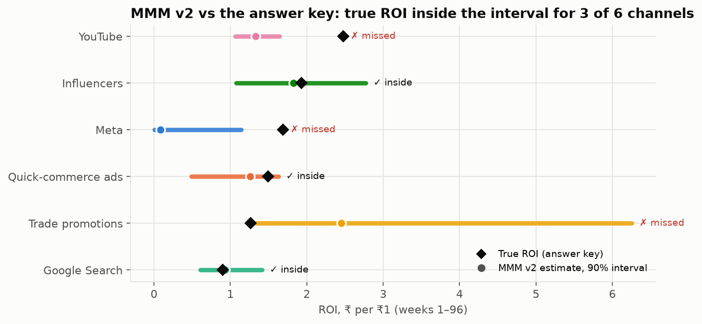

# The Growth Measurement Engine: Finding the Incremental Rupee at Prakriti Foods

A validated marketing-measurement system (Bayesian MMM + geo experiment + CLV + budget optimiser + AI agents) that tells a D2C brand's CFO which marketing rupees actually create sales, and how to cut spend from 28% to 20% of revenue with the least damage to contribution.

> **Disclaimer.** Prakriti Foods is a fictional company created for an independent student portfolio project. All company data is synthetic, generated by the author and calibrated to publicly reported benchmarks for Indian D2C brands (sources cited). No real company's data was used. Results demonstrate a method and are not claims about any real brand.

## TL;DR
- **The problem:** platforms claimed ₹253 Cr of revenue on ₹165 Cr of actual sales (1.53×). Platform ROAS cannot guide a budget cut.
- **The decision:** cut marketing from ₹33.5 Cr to ₹24 Cr by halving Meta, quick-commerce ads, Search and trade promotions, and growing YouTube (+50%) and Influencers (+46%).
  Graded against the sealed truth, this plan earns **₹11.0 Cr a year more** CLV-adjusted contribution than today, and ₹5.9 Cr more than an equal cut across channels. That **matches the best possible split** under the same ±50% limits.
- **Validated honestly:** the answer key was sealed before modelling and opened only after every decision was frozen.
  - The geo experiment recovered quick-commerce ads' true ROI (1.11 vs true 1.12).
  - CLV came within 2%, and the fraud detector caught all 13 fake influencers.
  - **MMM v2 failed its own coverage test (3 of 6 channels)** and overstated the plan's gain (₹10.1 Cr predicted vs ₹5.9 Cr true). Both misses are explained below.

## The CFO's question
Platforms together claim more revenue than the company earned. With marketing fixed at ₹24 Cr (20% of run-rate), which spend is incremental, and how should it be split?

## Approach
1. Synthetic data with a **self-sealed answer key**: true parameters are drawn at random, never printed, and saved to `truth.json`; its SHA-256 hash is committed publicly before any modelling and the file is opened only at grading
2. Attribution audit → OLS baseline → Bayesian MMM v1
3. Pre-registered geo-holdout experiment → MMM v2 calibrated with the lift
4. Cohort survival + CLV by acquisition channel
5. Budget optimiser at ₹24 Cr → integrated marketing P&L
6. Open the truth and grade every model
7. AI layer: value classifier, influencer fraud detector, "Ask Prakriti" copilot, budget-negotiation agents, budget-pacing agent with autonomy policy

## Validation against planted truth
Full report: `notebooks/10_grading_vs_truth.ipynb`; scorecard: `reports/validation_scorecard.csv`.

| Test (pre-registered unless noted) | Result | Verdict |
|---|---|---|
| MMM v2: true ROI inside 90% interval, ≥5 of 6 channels | 3 of 6 (missed Meta, YouTube, trade promotions) | FAIL |
| MMM v2: ROI ranking Spearman ≥ 0.8 | ρ = 0.14 | FAIL |
| MMM v2: holdout MAPE < 10% | 3.2% | PASS |
| Geo experiment: truth inside 90% CI | 1.11 (1.06–1.15) vs 1.12 | PASS |
| CLV: mean absolute error < 10% | 2.0%; 6 of 6 inside interval | PASS |
| Fraud detector (AI3), 10% setting | 13 of 13 fakes caught, precision 87% | — |
| Checkout A/B test: truth inside 95% CI | +0.34 pp vs +0.27 pp | PASS |
| Budget plan vs best possible split (true curves) | 100% of achievable gain; predicted gain overstated | — |

**Why the model missed (evidence in the report):**
- **Meta is near saturation.** Its true contribution barely moves week to week and follows the growth trend, so the model folded about ₹22 Cr of Meta's effect into baseline.
- **Trade promotions.** The model measured the gross promotion spike (true gross ROI 2.28 vs estimate 2.45) and missed the 44% of sales pulled forward from later weeks.
- **What it means:** MMM alone cannot be trusted for saturated, always-on channels. The next step is a Meta geo holdout, the same method that got quick-commerce ads right.

## Repository map
| Folder | Contents |
| --- | --- |
| `generator/` | `prakriti_world.py`: the documented data-generating process (ranges public, draw secret) |
| `data/generated/` | weekly_geo, platform_reported, customers, orders, cro_sessions, influencers |
| `sealed/` | `HASH.txt` (committed at sealing) and `truth.json` (committed only after grading) |
| `preregistration/` | Experiment design and analysis plan, committed before stage 2 |
| `notebooks/` | 00–11 analysis notebooks |
| `model/` | Integrated marketing P&L (Excel) and exported curve parameters |
| `app/` | Streamlit Budget Simulator |
| `ai/` | Agent tools, prompts, evaluation sets, traces |
| `reports/` | Measurement brief, data card, validation report, governance charter, deck |

## How to reproduce
1. Open `notebooks/00_setup_check.ipynb` in Colab and run all cells.
2. `pip install -r requirements.txt`
3. Run notebooks in numeric order.

## AI-assistance note
Code and drafting were produced with AI assistance and checked step by step by the author.

## Author
Anvesha · PGDM (E-Business), WeSchool Mumbai
